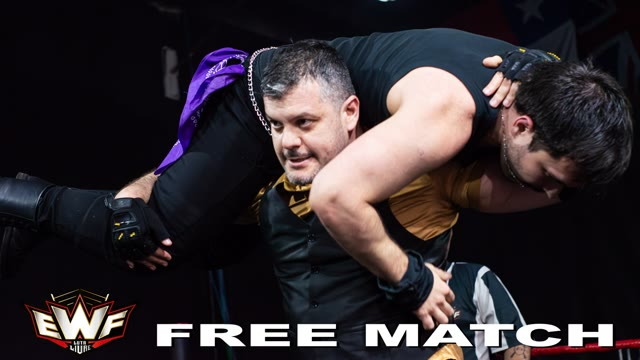
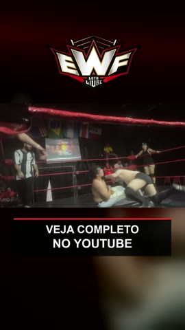

# Referências de edição EWF / EWF editing references

[PT](../README.md) · [EN](../README.en.md)

| Projeto / Project | Decisão observada / Observed decision | Aplicação / Application |
|---|---|---|
| Sobreviventes · evento completo | Lutas em sequência, entradas removidas, narração sobre ambiente, logo inferior direita e capítulos. Uma revisão tratou a narração da luta 4. / Sequential matches, entrances removed, commentary over venue sound, lower-right logo, chapters and a later match 4 commentary revision. | Meça sincronismo por luta e confira a versão da mixagem no master final. / Measure sync per match and confirm the final master uses the intended mix. |
| Última Noite 2026 · lutas grátis | O master foi dividido em seis lutas 1280 × 720 a 30 fps. Os limites usaram transições para preto. A última luta incluiu a fala final. / Six 720p30 matches split at inspected fades to black. The last included the closing speech. | Use o material para decidir limites e quantidade. / Derive count and boundaries from the footage. |
| Última Noite 2026 · Reels | Seis Reels individuais de 10 s e um compilado. Na revisão, a logo substituiu o cabeçalho de texto. A ação, o áudio e o CTA final foram preservados. / Six 10-second match Reels and one montage. A logo replaced the text header while approved action, sound and end card were preserved. | Para revisão gráfica, bloqueie trecho e áudio. / Lock selected action and sound for graphic revisions. |
| Revolution 2026 · Strong Style Society x ASH & Kali | Reel de uma luta avulsa, de 414,75 a 424,75 s na fonte. O arquivo entregue tem 240 quadros em 10 s. / Standalone match source, 414.75–424.75 s. Delivery has 240 frames in ten seconds. | Use o mesmo layout com a cadência da fonte. / Reuse the layout at the source cadence. |
| Última Noite 2026 · thumbnails | Fotos da série em 1600 × 900 com logo no canto inferior esquerdo e “FREE MATCH” em branco. / Series covers at 1600 × 900 with lower-left logo and white “FREE MATCH” lettering. | Use a referência da série para capas de luta e as instruções do pôster para adaptações. / Follow the series reference for match covers and the poster brief for adaptations. |

### Capa da série / Series cover

### Quadro final do Reel / Reel end frame

A logo incluída é o PNG EWF do projeto. As duas tarjas em `assets/overlays/` são adaptações reutilizáveis. As imagens acima são cópias reduzidas das edições anteriores. / The bundled logo is the project’s EWF PNG. The two overlays are reusable adaptations. The images above are reduced copies of earlier edits.

## Pedidos equivalentes / Equivalent briefs

| Português | English |
|---|---|
| Monte o show com narração, preserve o ambiente e inclua capítulos por luta. | Assemble the show with commentary, retain venue sound and add a chapter per match. |
| Separe o evento em lutas grátis e mantenha a decisão do árbitro em cada arquivo. | Split the event into free matches and keep the referee’s decision in each file. |
| Troque só o cabeçalho pela logo. Preserve o momento, o áudio e a chamada final do Reel. | Replace only the header with the logo. Preserve the selected moment, audio and end card. |
| Ajuste este pôster para thumbnail de YouTube sem acrescentar elementos. | Fit this poster to a YouTube thumbnail without adding elements. |
